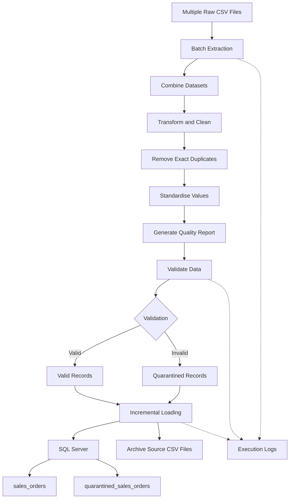
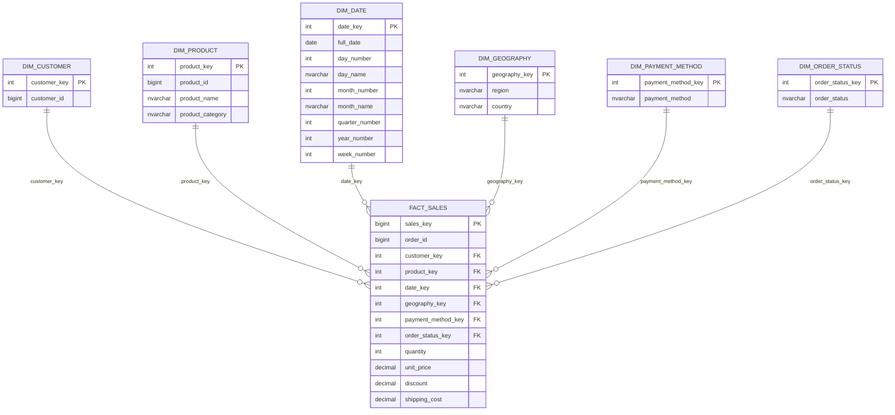
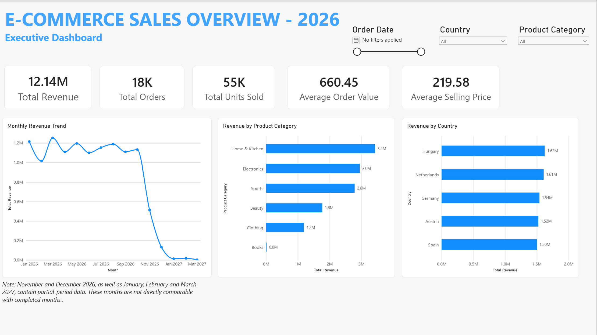
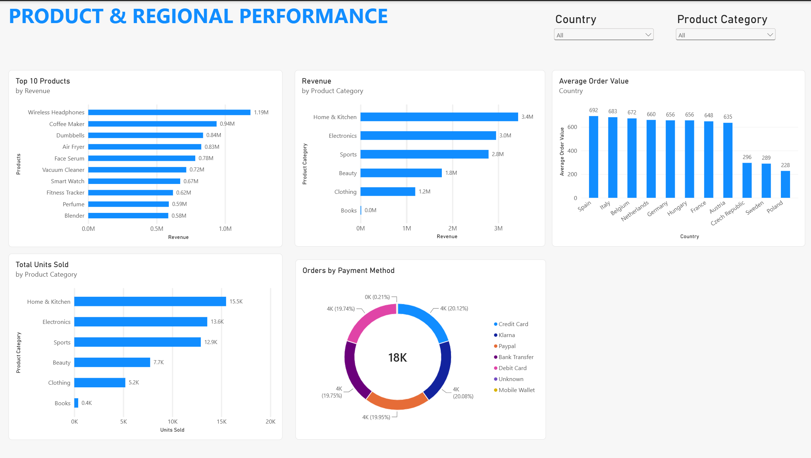
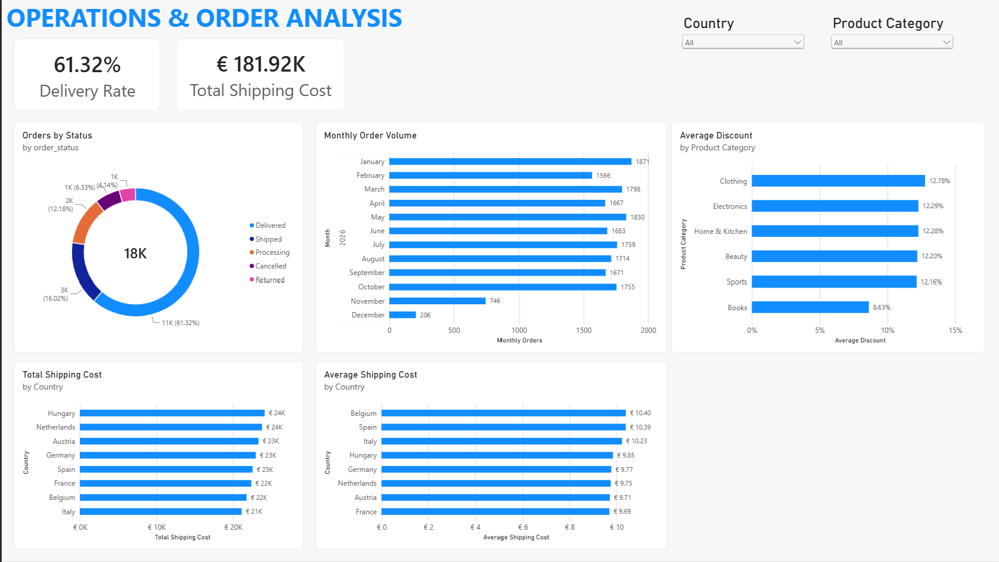

# E-Commerce Sales ETL Pipeline & Data Warehouse

An end-to-end data engineering and business intelligence project built using **Python, Pandas, SQL Server, SQLAlchemy and Power BI** to extract, transform, validate and analyse e-commerce sales data.

The project demonstrates a complete data engineering workflow, including batch extraction, data transformation, data-quality validation, quarantine management, incremental loading, dimensional data modelling, automated testing and interactive business intelligence reporting.

---

## 1. Project Overview

E-commerce businesses generate large volumes of transactional data. However, raw datasets often contain missing values, duplicate records, inconsistent formats and invalid numerical values.

This project demonstrates how to build an automated ETL pipeline that processes multiple raw e-commerce sales CSV files, applies data-cleaning and validation rules, separates invalid records for further investigation, and loads reliable data into Microsoft SQL Server.

The project was subsequently extended with a dimensional data warehouse and an interactive Power BI dashboard.

### Key Features

- Batch processing of multiple CSV files.
- Automated data-quality checks.
- Duplicate detection and removal.
- Incremental database loading.
- Quarantine management.
- Source-file archiving after successful processing.
- Error handling and logging.
- Automated testing using Pytest.
- SQL Server data warehouse using Star Schema modelling.
- Stored procedure-based incremental warehouse loading.
- ETL audit logging.
- Interactive Power BI dashboards.

---

## 2. Project Objectives

- Extract raw e-commerce sales data from multiple CSV files.
- Explore and profile datasets to identify data-quality issues.
- Remove duplicate records and standardise inconsistent values.
- Validate data types, dates and numerical values.
- Separate valid records from invalid records.
- Store invalid records in a quarantine table with rejection reasons.
- Load only new order IDs into SQL Server without deleting existing records.
- Prevent previously loaded order IDs from being inserted again.
- Build a dimensional data warehouse using a Star Schema.
- Automate warehouse loading through SQL Server stored procedures.
- Create interactive Power BI dashboards for business analysis.
- Monitor pipeline execution through logging and audit tracking.
- Test individual pipeline components using automated tests.

---

## 3. Technology Stack

| Technology | Purpose |
|---|---|
| Python | ETL pipeline development and orchestration |
| Pandas | Data extraction, cleaning and transformation |
| NumPy | Numerical operations |
| SQL Server | Relational database and data warehouse |
| SQL | Database queries, validation and dimensional modelling |
| SQLAlchemy | Database integration and data loading |
| PyODBC | SQL Server connectivity |
| Python-dotenv | Environment variable management |
| Pytest | Automated testing |
| Pytest-cov | Test coverage measurement |
| Power BI Desktop | Interactive dashboards, DAX measures and business intelligence reporting |
| Git & GitHub | Version control and project hosting |
| VS Code | Development environment |

---

## 4. ETL Architecture

The Python pipeline follows four main stages:

1. **Extract:** Discovers and reads all incoming CSV files from the raw data directory and combines them into a single DataFrame.
2. **Transform:** Removes exact duplicate records, standardises values and generates a data-quality report.
3. **Validate:** Checks data quality and separates valid and invalid records.
4. **Load:** Incrementally loads new valid records and quarantined records into separate SQL Server tables.

### ETL Workflow



### Incremental Loading Mechanism

Unlike a full-refresh approach, the pipeline does not delete existing records before loading new data.

The incremental loading process:

- Retrieves existing order IDs from both SQL Server tables.
- Compares incoming order IDs against existing records.
- Removes records whose order IDs have already been processed.
- Removes duplicate order IDs within incoming datasets.
- Inserts only new valid and quarantined records.
- Preserves previously loaded records.

This prevents duplicate order IDs from being loaded again when the pipeline is executed multiple times.

### Source-File Archiving

After successful database loading, the pipeline automatically moves processed CSV files from `data/raw/` to:

```text
data/processed/source_files/
```

This keeps the raw input directory ready for new incoming datasets and retains original source files for traceability.

If the database loading process fails, the source files are not archived.

---

## 5. Dataset Description

The project uses multiple e-commerce sales CSV datasets containing the same 14-column structure.

The original dataset contains **1,012 records**, including 12 exact duplicate records. Additional datasets are used to demonstrate batch processing and incremental loading.

| Column | Description |
|---|---|
| order_id | Unique order identifier |
| customer_id | Customer identifier |
| product_id | Product identifier |
| order_date | Date of the transaction |
| product_category | Product category |
| product_name | Product name |
| quantity | Number of units ordered |
| unit_price | Price per unit |
| discount | Applied discount |
| shipping_cost | Shipping cost |
| region | Sales region |
| country | Customer country |
| payment_method | Payment method |
| order_status | Order processing status |

### Identified Data Quality Issues

- Missing values in customer_id, unit_price, region and payment_method.
- Exact duplicate records.
- Mixed date formats.
- Inconsistent whitespace.
- Inconsistent capitalization in categorical columns.
- Negative quantities.
- Zero or negative unit prices.
- Invalid shipping costs and discount values.

---

## 6. Data Transformation and Validation

### Transformation

The transformation stage performs the following operations:

- Removes exact duplicate records.
- Strips unnecessary whitespace from text columns.
- Standardises order status and payment method capitalization.
- Generates a data-quality report.
- Saves the transformed dataset in the processed data directory.

### Validation

The validation stage checks:

- Required column availability.
- Duplicate records.
- Data types.
- Date validity.
- Missing values in mandatory fields.
- Negative quantities.
- Zero or negative unit prices.
- Negative shipping costs.
- Discounts outside the permitted 0–1 range.

### Quarantine Mechanism

Records that fail the defined validation rules are separated from valid records.

Two datasets are generated:

- `valid_records.csv`
- `quarantined_records.csv`

The quarantine dataset includes a `quarantine_reason` column explaining why a record was rejected.

This allows invalid records to be investigated without allowing them into the main validated sales table.

---

## 7. SQL Server Database Design

The project uses a SQL Server database named `EcommerceDB`.

### Source Tables

**dbo.sales_orders**

Stores records that pass the validation rules.

- `order_id` is the primary key.
- Stores validated sales transactions.
- Existing records are preserved during incremental loading.

**dbo.quarantined_sales_orders**

Stores invalid records along with their quarantine reasons.

The incremental loading process checks order IDs across both tables to avoid processing the same order ID again.

SQL scripts are available in `sql/source/`.

---

## 8. Data Warehouse Architecture

The project includes a SQL Server data warehouse built using a **Star Schema dimensional model** to support analytical reporting and business intelligence.

The warehouse consists of one central fact table connected to six dimension tables.

### 8.1 Star Schema Diagram

The following diagram illustrates the data warehouse architecture and its relationships.



### 8.2 Fact Table

**dw.fact_sales**

The central fact table stores sales transactions and measurable values.

Key attributes:

- `sales_key`: Surrogate primary key.
- `order_id`: Unique order identifier.
- Dimension foreign keys.
- `quantity`
- `unit_price`
- `discount`
- `shipping_cost`

The grain of the fact table is **one row per sales order record**.

### 8.3 Dimension Tables

| Dimension | Purpose |
|---|---|
| `dw.dim_customer` | Customer information |
| `dw.dim_product` | Product names and categories |
| `dw.dim_date` | Daily, monthly, quarterly and yearly analysis |
| `dw.dim_geography` | Region and country analysis |
| `dw.dim_payment_method` | Payment-method analysis |
| `dw.dim_order_status` | Order-status analysis |

### 8.4 Data Warehouse Features

- Star Schema dimensional modelling.
- Surrogate keys for dimension tables.
- Foreign key relationships between fact and dimension tables.
- Unknown dimension members for handling missing values.
- Incremental loading of new records.
- Stored procedure-based warehouse loading.
- ETL execution auditing and error logging.
- Duplicate prevention and data reconciliation.

### 8.5 Warehouse ETL Workflow

1. Extract incoming CSV files from the raw data folder.
2. Transform and standardise the extracted records.
3. Validate records and separate invalid records into quarantine.
4. Incrementally load valid records into the SQL Server source tables.
5. Execute the `dw.usp_load_warehouse` stored procedure from Python.
6. Load new records into the warehouse dimensions and fact table.
7. Record execution details in `dw.etl_audit_log`.
8. Archive successfully processed source CSV files.

### 8.6 Warehouse Documentation

- [Star Schema Documentation](sql/warehouse/Documentation/star_schema.md)
- [ETL Workflow Documentation](sql/warehouse/Documentation/ETL_Workflow.md)

---

## 9. Project Structure

```text
ETL_Project/
│
├── data/
│   ├── raw/
│   └── processed/
│       └── source_files/
│
├── logs/
│
├── scripts/
│   ├── __init__.py
│   ├── explore_data.py
│   ├── extract.py
│   ├── load.py
│   ├── logging_config.py
│   ├── profile_data.py
│   ├── transform.py
│   └── validate.py
│
├── tests/
│
├── sql/
│   ├── source/
│   │   ├── create_database.sql
│   │   ├── create_tables.sql
│   │   └── query.sql
│   │
│   └── warehouse/
│       ├── 01_setup/
│       ├── 02_initial_load/
│       ├── 03_procedures/
│       ├── 04_validation/
│       └── Documentation/
│           ├── ETL_Workflow.md
│           └── star_schema.md
│
├── reports/
│   ├── ETL_Dashboard.pbix
│   ├── Ecommerce_Dashboard_DW.pbix
│   └── Screenshots/
│
├── main.py
├── requirements.txt
├── README.md
├── AGENTS.md
├── .env.example
└── .gitignore
```

**Note:** Raw datasets, processed datasets, log files, virtual environments and the actual `.env` configuration file are excluded from Git tracking.

---

## 10. Power BI Data Warehouse Dashboard

A three-page interactive Power BI dashboard connected directly to the SQL Server data warehouse using the Star Schema model.

### 10.1 Dashboard Pages

**1. Executive Overview**

- Total Revenue
- Total Orders
- Total Units Sold
- Average Order Value (AOV)
- Average Selling Price (ASP)
- Monthly revenue trends
- Revenue by product category and country

**2. Product & Regional Performance**

- Top 10 products by revenue
- Revenue by product category
- Average order value by country
- Units sold by category
- Orders by payment method

**3. Operations & Order Analysis**

- Delivery rate
- Total shipping costs
- Orders by order status
- Monthly order volume
- Average discount by category
- Shipping cost analysis by country

### 10.2 Data Model

The dashboard uses seven warehouse tables:

- `dw.fact_sales`
- `dw.dim_customer`
- `dw.dim_product`
- `dw.dim_date`
- `dw.dim_geography`
- `dw.dim_payment_method`
- `dw.dim_order_status`

### 10.3 Key Features

- Star Schema dimensional model.
- Six one-to-many relationships.
- DAX-based business KPIs.
- Interactive country, date and category slicers.
- Monthly, geographical and product-level analysis.
- Warehouse-powered reporting.

### 10.4 Power BI Report Files

| Report | Description |
|---|---|
| `ETL_Dashboard.pbix` | Original three-page sales dashboard |
| `Ecommerce_Dashboard_DW.pbix` | Warehouse-connected dashboard |

Both reports are available in the `reports/` directory.

### 10.5 Screenshots of the Report

The following screenshots showcase the three pages of the warehouse-connected Power BI dashboard.

## Power BI Dashboard Screenshots

### 1. Executive Overview


### 2. Product Performance


### 3. Operations Analysis


---

## 11. Installation and Setup

### Prerequisites

- Python installed.
- Microsoft SQL Server installed and configured.
- SQL Server Management Studio (SSMS) or VS Code SQL Server extension.
- Microsoft ODBC Driver 17 for SQL Server.
- Git installed.
- Power BI Desktop (for opening the dashboard).

### Step 1: Clone the Repository

```bash
git clone https://github.com/abhinandan2611/Ecommerce-Sales-ETL-Pipeline.git

cd Ecommerce-Sales-ETL-Pipeline
```

### Step 2: Create a Virtual Environment

```bash
python -m venv .venv
```

Activate it on Windows PowerShell:

```powershell
.\.venv\Scripts\Activate.ps1
```

### Step 3: Install Dependencies

```bash
python -m pip install -r requirements.txt
```

For running automated tests, install:

```bash
python -m pip install pytest pytest-cov
```

### Step 4: Configure Environment Variables

Create a `.env` file in the project root using `.env.example` as a template.

Configure your SQL Server connection:

```env
DB_SERVER=YOUR_SERVER_NAME
DB_NAME=EcommerceDB
DB_DRIVER=ODBC Driver 17 for SQL Server
DB_TRUSTED_CONNECTION=yes
DB_ENCRYPT=yes
DB_TRUST_SERVER_CERTIFICATE=yes
```

Update the server name to match your SQL Server instance.

**The `.env` file should never be committed to GitHub.**

### Step 5: Create the Source Database and Tables

Execute the SQL scripts in the following order:

1. `sql/source/create_database.sql`
2. `sql/source/create_tables.sql`

This creates the `EcommerceDB` database and the required source tables.

### Step 6: Set Up the Data Warehouse

Execute the warehouse SQL scripts in the documented order:

1. `01_setup/`
2. `02_initial_load/`
3. `03_procedures/`

Use the validation scripts in `04_validation/` to verify the warehouse.

Refer to the warehouse documentation for details.

### Step 7: Add Raw Datasets

Place one or more source CSV files inside:

```text
data/raw/
```

The pipeline automatically discovers all CSV files in this directory.

**Important:** All incoming CSV files must have the same column names and column order.

### Step 8: Run the ETL Pipeline

From the project root, execute:

```bash
python main.py
```

The pipeline automatically performs:

1. Batch extraction of incoming CSV files.
2. Data transformation and cleaning.
3. Data validation and quarantine separation.
4. Incremental loading into SQL Server.
5. Incremental warehouse loading through the stored procedure.
6. Source-file archiving after successful processing.

### Step 9: Run Automated Tests

Execute:

```bash
python -m pytest
```

To run tests with coverage:

```bash
python -m pytest --cov=scripts --cov-report=term-missing
```

---

## 12. Execution Results

The following results represent an initial execution using the original dataset, rather than cumulative results from subsequent batch executions.

| Metric | Initial Result |
|---|---:|
| Original records extracted | 1,012 |
| Duplicate records removed | 12 |
| Transformed records | 1,000 |
| Valid records loaded | 982 |
| Quarantined records | 18 |
| Total records processed | 1,000 |
| Observed execution time | 0.66 seconds |

### SQL Data Quality Verification

The initial database load was independently verified using SQL queries.

| Validation Check | Result |
|---|---|
| Valid record count | 982 |
| Quarantined record count | 18 |
| Duplicate order IDs in valid table | 0 |
| Missing order IDs | 0 |
| Missing product IDs | 0 |
| Missing order dates | 0 |
| Missing unit prices | 0 |
| Invalid numeric values in valid table | 0 |

These checks confirmed that the initial database load contained the expected records and that the defined validation rules were enforced.

*Execution time is based on one observed run and may vary depending on the system and dataset size.*

---

## 13. Automated Testing and Code Coverage

The project includes automated tests using **Pytest** to verify individual ETL components.

Test coverage includes:

- CSV discovery and single-file extraction.
- Multiple CSV file extraction and combination.
- Data exploration and profiling.
- Data transformation and cleaning.
- Data validation and quarantine.
- Incremental SQL Server loading.
- Duplicate order ID handling.
- Database connection.
- Logging configuration.
- Error handling and edge cases.

### Running Tests

Run all tests:

```bash
python -m pytest
```

Run tests with coverage:

```bash
python -m pytest --cov=scripts --cov-report=term-missing
```

### Test Coverage Results

The project achieved **98% overall test coverage** in the latest reported test run.

| Module | Coverage |
|---|---:|
| explore_data.py | 98% |
| extract.py | 100% |
| load.py | 98% |
| logging_config.py | 100% |
| profile_data.py | 96% |
| transform.py | 99% |
| validate.py | 98% |
| **Overall** | **98%** |

The test suite helps verify pipeline behaviour, identify regressions and improve code reliability.

---

## 14. Logging and Monitoring

The project uses Python's logging module with console and rotating file handlers.

Logging captures:

- Pipeline execution status.
- Number of files extracted.
- Number of records extracted.
- Transformation results.
- Validation results.
- Number of new valid records loaded.
- Number of new quarantined records loaded.
- Pipeline failures and exceptions.
- Total execution time.
- Source-file archiving details.

Log files are stored in:

```text
logs/etl_pipeline.log
```

The logging configuration uses a rotating file handler with a maximum file size of 5 MB and three backup files.

The data warehouse also includes an audit table:

`dw.etl_audit_log`

This records warehouse execution details, inserted records, failed records and execution status.

---

## 15. Future Enhancements

Potential improvements for future versions include:

- Implementing scheduled pipeline execution.
- Supporting additional input formats such as Excel and JSON.
- Introducing automated data-quality monitoring and alerting.
- Implementing pipeline orchestration using Apache Airflow or similar tools.
- Adding database-level audit and load-history tracking.
- Improving scalability for larger datasets.
- Automating Power BI dataset refreshes.

---

## 16. Author

**Abhinandan Manohar**

MSc Business Intelligence and Data Science

Interests: Data Engineering, Business Intelligence, Data Analytics and Python.

---

*This project was developed as a practical learning project to demonstrate an end-to-end data engineering and business intelligence workflow using Python, Microsoft SQL Server and Power BI.*