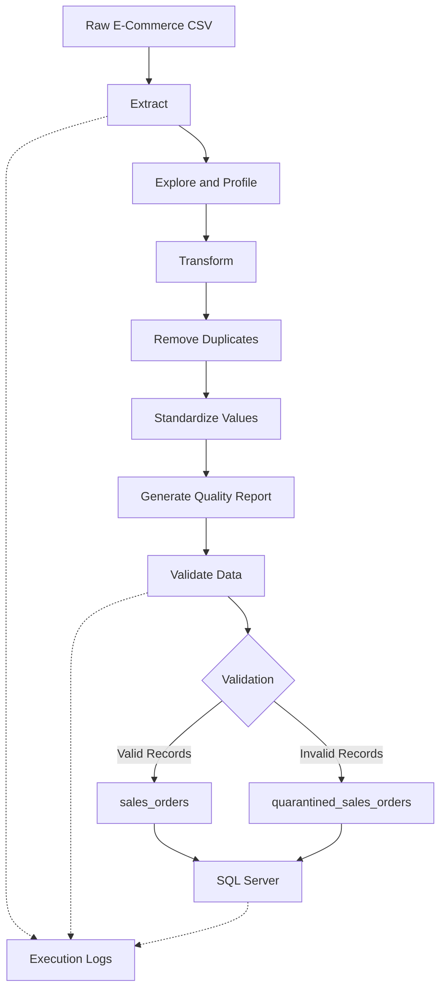

# E-Commerce Sales ETL Pipeline

An end-to-end ETL (Extract, Transform, Load) pipeline built using **Python, Pandas, SQL Server and SQLAlchemy** to process e-commerce sales data, identify data-quality issues, validate records and load reliable data into a relational database.

The project demonstrates an automated data engineering workflow, including data extraction, transformation, validation, quarantine management, database loading, logging and automated testing.

---

## 1. Project Overview

E-commerce businesses generate large volumes of transactional data. However, raw datasets often contain missing values, duplicate records, inconsistent formats and invalid numerical values.

This project demonstrates how to build an automated ETL pipeline that processes raw e-commerce sales data, applies data-cleaning and validation rules, separates invalid records for further investigation, and loads the resulting datasets into Microsoft SQL Server.

The pipeline also includes:

- Automated data-quality checks
- Error handling and logging
- Quarantine management
- SQL Server integration
- Automated testing using Pytest
- Execution-time monitoring

## 2. Project Objectives

- Extract raw e-commerce sales data from CSV files.
- Explore and profile datasets to identify data-quality issues.
- Remove duplicate records and standardize inconsistent values.
- Validate data types, dates and numerical values.
- Separate valid records from invalid records.
- Store invalid records in a quarantine table with rejection reasons.
- Load validated data into SQL Server.
- Monitor pipeline execution through logging and execution-time tracking.
- Test individual pipeline components using automated tests.

## 3. Technology Stack

| Technology | Purpose |
|---|---|
| Python | ETL pipeline development |
| Pandas | Data extraction, cleaning and transformation |
| NumPy | Numerical operations |
| SQL Server | Relational database storage |
| SQLAlchemy | Database integration and data loading |
| PyODBC | SQL Server connectivity |
| Python-dotenv | Environment variable management |
| Pytest | Automated testing |
| Pytest-cov | Test coverage measurement |
| Git & GitHub | Version control and project hosting |
| VS Code | Development environment |

## 4. ETL Architecture

The pipeline follows four main stages:

1. **Extract:** Reads raw CSV datasets into Pandas DataFrames.
2. **Transform:** Removes duplicate records, standardizes values and generates a data-quality report.
3. **Validate:** Checks data quality and separates valid and invalid records.
4. **Load:** Loads validated records and quarantined records into separate SQL Server tables.

### Workflow



## 5. Dataset Description

The project uses a sample e-commerce sales dataset containing **1,012 records and 14 columns**.

| Column | Description |
|---|---|
| order_id | Unique order identifier |
| customer_id | Customer identifier |
| product_id | Product identifier |
| order_date | Date of the transaction |
| product_category | Product category |
| product_name | Product name |
| quantity | Number of units ordered |
| unit_price | Price per unit |
| discount | Applied discount |
| shipping_cost | Shipping cost |
| region | Sales region |
| country | Customer country |
| payment_method | Payment method |
| order_status | Order processing status |

The dataset intentionally includes data-quality issues to demonstrate the ETL process.

### Identified Data Quality Issues

- Missing values in customer_id, unit_price, region and payment_method.
- 12 exact duplicate records.
- Mixed date formats.
- Inconsistent whitespace.
- Inconsistent capitalization in categorical columns.
- Negative quantities.
- Zero or negative unit prices.
- Invalid shipping costs and discount values.

## 6. Data Transformation and Validation

### Transformation

The transformation stage performs the following operations:

- Removes exact duplicate records.
- Strips unnecessary whitespace from text columns.
- Standardizes order status and payment method capitalization.
- Generates a data-quality report.
- Saves the transformed dataset in the processed data directory.

### Validation

The validation stage checks:

- Required column availability.
- Duplicate records.
- Data types.
- Date validity.
- Missing values in mandatory fields.
- Negative quantities.
- Zero or negative unit prices.
- Negative shipping costs.
- Discounts outside the permitted 0–1 range.

### Quarantine Mechanism

Records that fail the defined validation rules are separated from valid records.

Two datasets are generated:

- `valid_records.csv`
- `quarantined_records.csv`

The quarantine dataset includes a `quarantine_reason` column explaining why a record was rejected.

This allows invalid records to be investigated without allowing them into the main validated sales table.

## 7. SQL Server Database Design

The project uses a SQL Server database named `EcommerceDB`.

Two tables are created:

### dbo.sales_orders

Stores records that pass the validation rules.

### dbo.quarantined_sales_orders

Stores invalid records along with their quarantine reasons.

The `order_id` column is defined as the primary key in the valid sales table.

SQL scripts are available in the `sql/` directory.

## 8. Project Structure

```text
ETL_Project/
│
├── data/
│   ├── raw/
│   └── processed/
│
├── logs/
│
├── scripts/
│   ├── __init__.py
│   ├── explore_data.py
│   ├── extract.py
│   ├── load.py
│   ├── logging_config.py
│   ├── profile_data.py
│   ├── transform.py
│   └── validate.py
│
├── sql/
│   ├── create_database.sql
│   ├── create_tables.sql
│   └── query.sql
│
├── tests/
│   ├── test_connection.py
│   ├── test_explore_data.py
│   ├── test_extract.py
│   ├── test_load.py
│   ├── test_logging_config.py
│   ├── test_profile_data.py
│   ├── test_transform.py
│   └── test_validate.py
│
├── main.py
├── requirements.txt
├── README.md
├── AGENTS.md
├── .env.example
└── .gitignore
```

**Note:** Raw datasets, processed datasets, log files, virtual environments and the actual `.env` configuration file are excluded from Git tracking.

## 9. Installation and Setup

### Prerequisites

- Python installed.
- Microsoft SQL Server installed and configured.
- SQL Server Management Studio (SSMS) or VS Code SQL Server extension.
- Microsoft ODBC Driver 17 for SQL Server.
- Git installed.

### Step 1: Clone the Repository

```bash
git clone https://github.com/abhinandan2611/Ecommerce-Sales-ETL-Pipeline.git

cd Ecommerce-Sales-ETL-Pipeline
```

### Step 2: Create a Virtual Environment

```bash
python -m venv .venv
```

Activate it on Windows PowerShell:

```powershell
.\.venv\Scripts\Activate.ps1
```

### Step 3: Install Dependencies

```bash
python -m pip install -r requirements.txt
```

For running automated tests, install:

```bash
python -m pip install pytest pytest-cov
```

### Step 4: Configure Environment Variables

Create a `.env` file in the project root using `.env.example` as a template.

Configure your SQL Server connection:

```env
DB_SERVER=YOUR_SERVER_NAME
DB_NAME=EcommerceDB
DB_DRIVER=ODBC Driver 17 for SQL Server
DB_TRUSTED_CONNECTION=yes
DB_ENCRYPT=yes
DB_TRUST_SERVER_CERTIFICATE=yes
```

Update the server name to match your SQL Server instance.

**The `.env` file should never be committed to GitHub.**

### Step 5: Create the Database and Tables

Execute the SQL scripts in the following order:

1. `sql/create_database.sql`
2. `sql/create_tables.sql`

This creates the `EcommerceDB` database and the required tables.

### Step 6: Add the Raw Dataset

Place the source CSV file inside:

```text
data/raw/
```

The pipeline discovers CSV files from this directory and currently expects exactly one raw CSV file.

### Step 7: Run the ETL Pipeline

From the project root, execute:

```bash
python main.py
```

The pipeline automatically performs extraction, transformation, validation and loading.

## 10. Execution Results

The following results were obtained from a successful pipeline execution.

| Metric | Result |
|---|---:|
| Original records extracted | 1,012 |
| Duplicate records removed | 12 |
| Transformed records | 1,000 |
| Valid records loaded | 982 |
| Quarantined records | 18 |
| Total records in SQL Server | 1,000 |
| Observed execution time | 0.66 seconds |

### SQL Data Quality Verification

The loaded data was independently verified using SQL queries.

| Validation Check | Result |
|---|---|
| Valid record count | 982 |
| Quarantined record count | 18 |
| Duplicate order IDs in valid table | 0 |
| Missing order IDs | 0 |
| Missing product IDs | 0 |
| Missing order dates | 0 |
| Missing unit prices | 0 |
| Invalid numeric values in valid table | 0 |

These checks confirmed that the database contained the expected records and that the defined validation rules were enforced.

*Execution time is based on one observed run and may vary depending on the system and dataset size.*

## 11. Automated Testing and Code Coverage

The project includes automated tests using **Pytest** to verify individual ETL components.

Test coverage includes:

- CSV discovery and extraction
- Data exploration and profiling
- Data transformation and cleaning
- Data validation and quarantine
- SQL Server loading
- Database connection
- Logging configuration
- Error handling and edge cases

### Running Tests

Run all tests:

```bash
python -m pytest
```

Run tests with coverage:

```bash
python -m pytest --cov=scripts --cov-report=term-missing
```

### Test Coverage Results

The project achieved **98% overall test coverage**.

| Module | Coverage |
|---|---:|
| explore_data.py | 98% |
| extract.py | 100% |
| load.py | 98% |
| logging_config.py | 100% |
| profile_data.py | 96% |
| transform.py | 99% |
| validate.py | 98% |
| **Overall** | **98%** |

The tests help verify pipeline behaviour, identify regressions and improve code reliability.

## 12. Logging and Monitoring

The project uses Python's logging module with console and rotating file handlers.

Logging captures:

- Pipeline execution status.
- Extraction details.
- Transformation results.
- Validation results.
- Database loading status.
- Pipeline failures and exceptions.
- Total execution time.

Log files are stored in:

```text
logs/etl_pipeline.log
```

The logging configuration uses a rotating file handler with a maximum file size of 5 MB and three backup files.

## 13. Future Enhancements

Potential improvements for future versions include:

- Integrating Power BI for interactive sales dashboards.
- Implementing incremental data loading instead of full refresh.
- Adding scheduled pipeline execution.
- Supporting multiple input formats such as Excel and JSON.
- Introducing automated data-quality monitoring.
- Implementing pipeline orchestration using Apache Airflow or similar tools.
- Adding more advanced data engineering and analytical capabilities.

## 14. Author

**Abhinandan Manohar**

MSc Business Intelligence and Data Science

Interests: Data Engineering, Business Intelligence, Data Analytics and Python.

---

*This project was developed as a practical learning project to demonstrate an end-to-end ETL workflow using Python and Microsoft SQL Server.*
