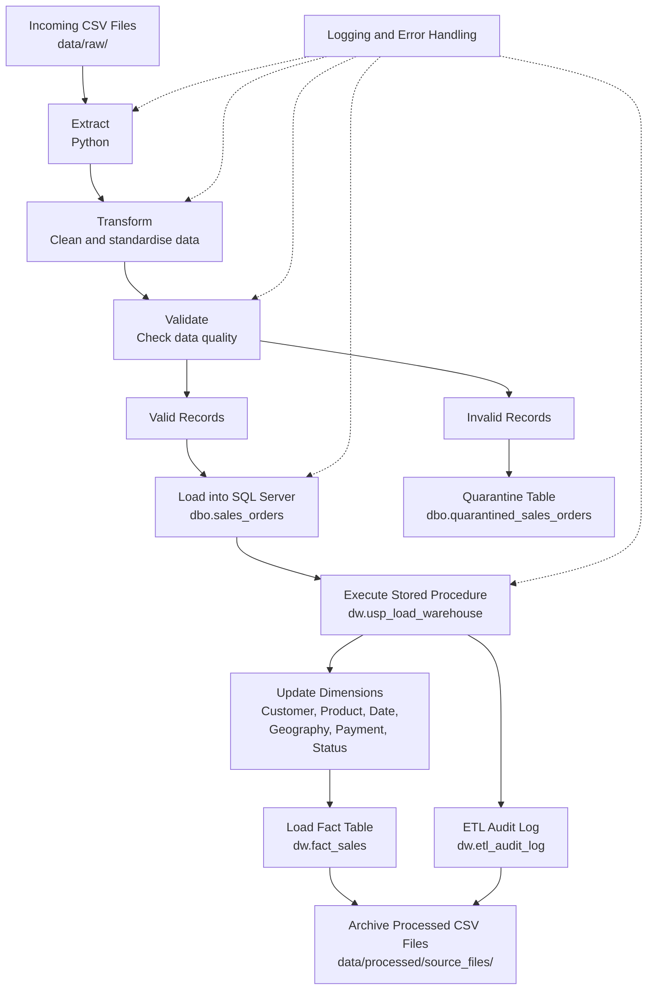

# E-commerce ETL Workflow

## Overview

The project uses a Python-based ETL pipeline integrated with SQL Server to process e-commerce sales data and incrementally load it into a dimensional data warehouse.

## ETL Workflow Diagram

## Workflow Description

1. **Extract:** Python discovers and reads incoming CSV files from the raw data directory.
2. **Transform:** Data is cleaned, standardised and prepared for loading.
3. **Validate:** Records are checked for data quality issues. Valid and invalid records are separated.
4. **Load:** Valid records are incrementally inserted into `dbo.sales_orders`, while invalid records are stored in `dbo.quarantined_sales_orders`.
5. **Warehouse Loading:** Python executes `dw.usp_load_warehouse` to update the dimension tables and insert new records into `dw.fact_sales`.
6. **Audit:** Warehouse execution details, including inserted records and execution status, are recorded in `dw.etl_audit_log`.
7. **Archive:** Source CSV files are moved to the archive only after the pipeline completes successfully.

## Error Handling

The pipeline uses Python logging and exception handling to capture execution errors. The warehouse stored procedure uses SQL transactions to protect warehouse loads from partial commits.

If warehouse loading fails, the source CSV files are not archived, allowing the pipeline to be retried.

## Technology Stack

- Python: Extraction, transformation, validation and orchestration.
- Pandas: Data manipulation and cleaning.
- SQL Server: Source database and data warehouse.
- SQL Stored Procedures: Incremental warehouse loading.
- SQLAlchemy and pyodbc: Python-to-SQL Server connectivity.
- Logging: Pipeline execution tracking.